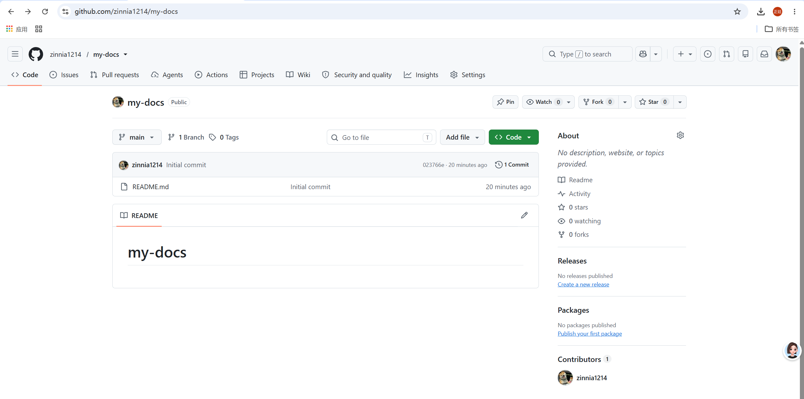
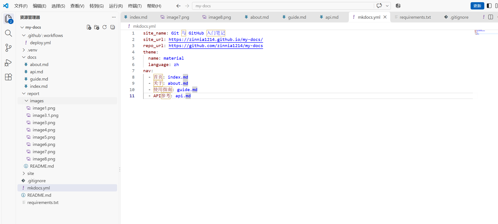
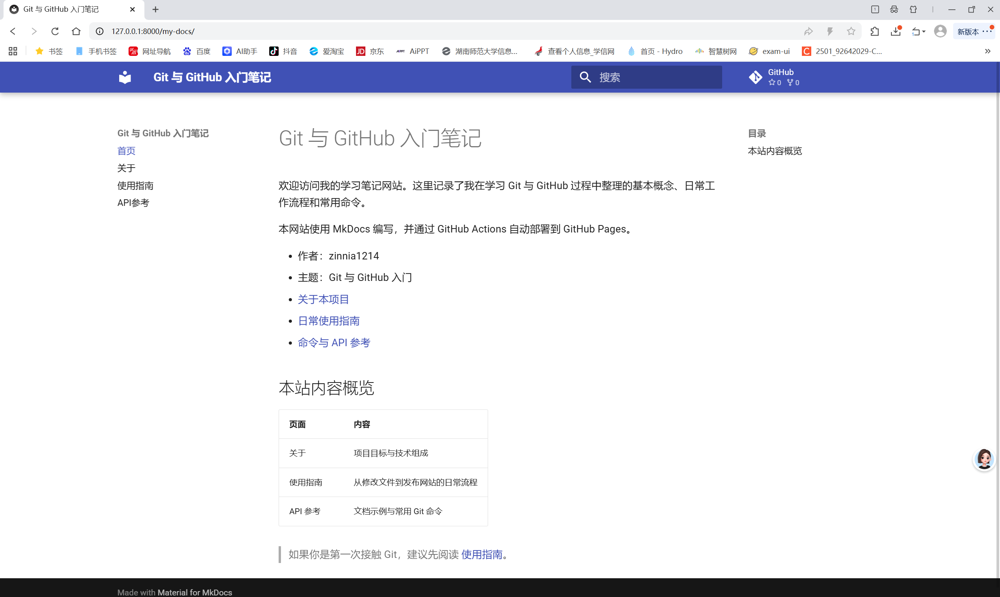
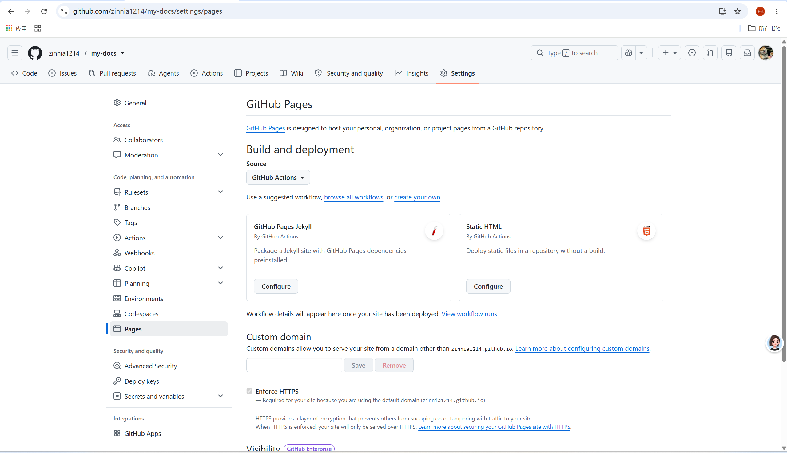
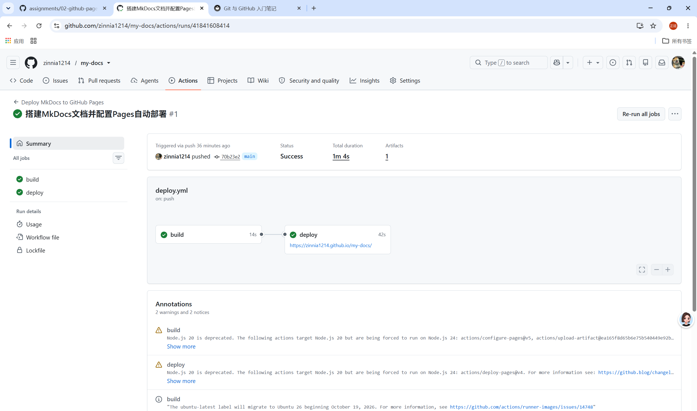
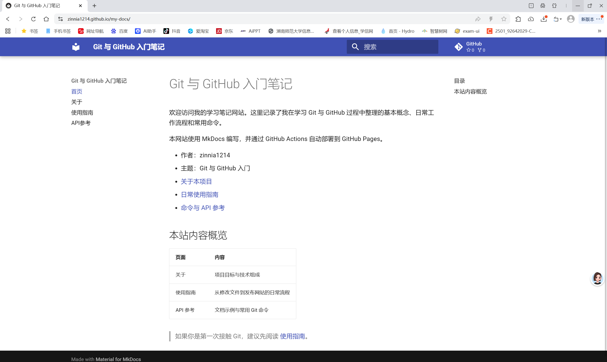
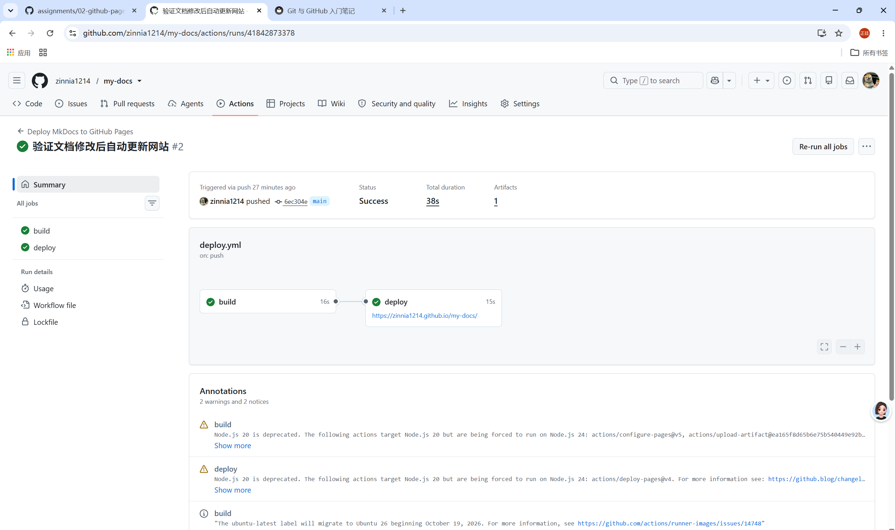
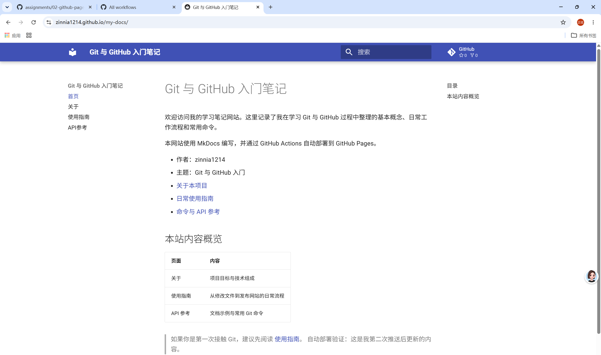

# 实践项目2：个人实验报告

## 1. 基本信息
- GitHub 登录名：zinnia1214
- 个人仓库地址：https://github.com/zinnia1214/my-docs
- 最终网站地址：https://zinnia1214.github.io/my-docs/

## 2. 实践过程与关键截图

### 2.1 仓库创建
我在 GitHub 上新建了一个公开仓库，仓库名 `my-docs`。选择 Public 的原因：GitHub Pages **仅公开仓库可以免费直接使用**，私有仓库使用 Pages 需要付费；创建完成后，在本地把仓库克隆到电脑，作为 MkDocs 文档项目的工作目录。创建成功后仓库是空的，后续在本地搭建项目再推送代码到远端。

### 2.2 项目结构与 MkDocs 配置
- `docs/`：存放所有 Markdown 源文档，也就是我们写的原始内容（index.md、about.md、guide.md、api.md），是我们**手动编辑维护**的源码；
- `site/`：`mkdocs build` 自动生成的静态网页目录，里面是编译后的 html、css、js，由程序自动生成，**不手动修改**；
- `nav`：mkdocs.yml 里的导航配置，用来定义网页顶部导航栏的条目、顺序，绑定对应的 md 文件，控制网站菜单。

### 2.3 本地构建或预览
本地先创建虚拟环境，安装依赖，依次执行：
`pip install -r requirements.txt`、`mkdocs build`、`mkdocs serve`。
`mkdocs serve` 启动本地预览服务，访问 `http://127.0.0.1:8000/my-docs/`，依次打开首页、关于、使用指南、API 参考四个页面，检查文字、导航跳转是否正常，确认文档内容排版没有问题之后再推送到 GitHub。

### 2.4 Pages 设置
发布来源选择 GitHub Actions，而不是直接从分支部署。原因：我们使用 MkDocs，需要**先编译 md 源码生成静态网页**，再上传发布；Actions 可以自动执行编译、打包、部署整套流程，每次 push 代码自动完成构建，不用我在本地 build 之后手动上传 site 文件夹，实现自动化持续部署。

### 2.5 Actions 首次构建和部署
- build：拉取仓库代码、安装 python 依赖、执行 mkdocs build，把 docs 下的 md 源码编译成静态网站文件；
- deploy：把 build 产出的静态网站文件，上传到 GitHub Pages 服务，对外发布网页。
提交代码推送后，workflow 自动触发，两个任务依次执行，最终绿色对勾代表部署成功。

### 2.6 网站访问与四页导航检查
打开 `https://zinnia1214.github.io/my-docs/`，依次点击导航栏：首页、关于、使用指南、API 参考，逐个检查页面跳转正常、文字内容展示正常，没有 404、样式错乱，确认线上网站和本地预览效果一致。

### 2.7 第二次推送与自动更新验证
- 对应提交链接：https://github.com/zinnia1214/my-docs/commit/6ec304e
- 对应 Actions 运行链接：https://github.com/zinnia1214/my-docs/actions/runs/41842873378
说明：我修改了 docs/index.md 首页内容，增加一段文字，再次执行 git add、commit、push；推送后自动触发同一个 workflow，重新 build+deploy，线上网站几秒到一分钟后刷新，看到内容更新，验证自动更新机制生效。

## 3. 问题与解决
本次实践中没有出现严重报错，重点核对了这些配置和日志：
1. 核对 `.gitignore`，确认 `.venv`、`site` 目录不会被提交，避免把本地虚拟环境、编译产物上传仓库；
2. 核对 `mkdocs.yml` 的 `site_url`，地址和自己的 github pages 网址保持一致，防止页面路径、静态资源加载异常；
3. 核对仓库 Settings → Actions → General 权限，选择`Allow all actions and reusable workflows`，给流水线足够权限去部署 Pages；
4. 核对 Pages 来源设置为 GitHub Actions，而不是 Branch，否则 workflow 无法正常发布。

## 4. 原理理解
1. docs/ 和 site/ 各保存什么？为什么不用手工修改 site/？`docs/`：存放 Markdown 源码，是我们编写、维护的原始文档；`site/`：mkdocs 自动编译生成的静态网页（html/css/js）。
site 是编译产物，每次 build 都会被清空重写，手动修改 site 里的内容，下次 build 就会覆盖丢失，所以不能手工改 site。
2. 本次工作流在什么情况下自动运行？
当代码推送到 main 分支（`git push origin main`），并且本次推送包含 workflow 监听的文件（mkdocs.yml、docs 下 md 文件、deploy.yml 等）时，自动触发运行。
3. build 与 deploy 两个任务有什么区别？
build：编译阶段，安装依赖、执行 mkdocs build，将 md 源码生成静态网站文件；
deploy：发布阶段，把 build 生成好的静态文件上传部署到 GitHub Pages 服务，让外网可以访问网站。
build 是打包，deploy 是上线发布。
4. 只修改 report/README.md 会触发部署吗？为什么？
不会触发。本次 `deploy.yml` 在 `on.push` 下配置了 `paths` 过滤，只监听 `docs/**`、`mkdocs.yml`、`requirements.txt` 和 `.github/workflows/deploy.yml`；`report/` 不在监听范围内，所以只改报告不会启动工作流。报告属于作业说明而不是网站内容，改它不改变站点，也不需要重新构建部署；要验证自动部署，必须修改 `docs/` 下的文档或 `mkdocs.yml`。
5. 本次方案为何无需创建 gh-pages 分支？
传统方案是 build 之后把 site 目录推送到 gh-pages 分支；而使用 GitHub Actions + Pages 新 API 的部署方式，workflow 直接把静态网站上传到 Pages 的部署环境，不需要手动维护 gh-pages 分支，系统内部托管网页资源，仓库分支只保留源码。

## 5. 我的体会
这次实践让我理解了 MkDocs 静态文档和 GitHub Pages 自动化部署的完整流程。以前我以为网页都要手写 html，现在知道可以用简单的 Markdown 写文档，由工具自动编译成网页；同时体会到 Git 和 CI/CD 的价值：只需要提交源码，流水线自动完成构建和发布，线上网站同步更新。
整个过程里，配置文件路径、权限设置、区分源码和编译产物是很容易踩坑的地方，也让我养成了先本地 serve 预览、确认没问题再推送远端的习惯。这套方案很适合写笔记、项目文档，后续我也可以用这个方式搭建自己的技术笔记网站。
